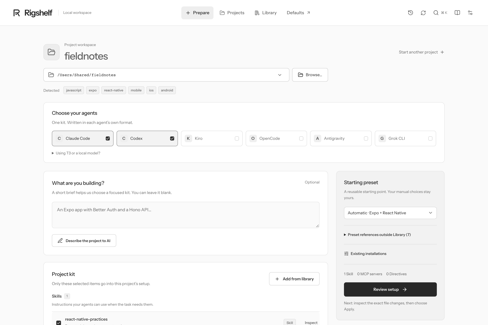
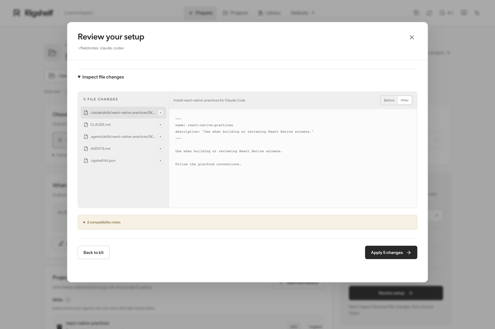

<p align="center">
  
</p>

<h1 align="center">Rigshelf</h1>

<p align="center">
  Set up coding agents for each project from your own library.<br>
  <a href="https://rigshelf.doguyilmaz.com">Website</a> ·
  <a href="https://rigshelf.doguyilmaz.com/docs/">Docs</a> ·
  <a href="#install">Install</a>
</p>

<p align="center"><b>Claude Code · Codex · Kiro · OpenCode · Antigravity · Grok CLI</b></p>



Keep your Skills, MCP servers, Plugins and directives in one local Library. For each project, pick the few that belong there and the agents you use. Rigshelf writes them in each agent's own format, and shows you every file before anything changes.

## Install

```sh
brew install doguyilmaz/tap/rigshelf
```

Or run it without installing: `bunx @doguyilmaz/rigshelf ui`. Prebuilt executables for macOS, Linux and Windows are on the [releases page](https://github.com/doguyilmaz/rigshelf/releases).

## Quick start

1. **Open the workbench:** `rigshelf ui` prints a private link such as `http://rigshelf.localhost:47471/#access=…`. It runs on your machine only.
2. **Choose a project folder.** Rigshelf detects the stack and suggests a starting kit.
3. **Pick your agents and the Skills or MCP servers to include.** The Library can be large; the kit stays small.
4. **Review and apply.** You see each file that will be written. Every change can be rolled back.



Reopen your agent afterwards so it picks up the new files. The [walkthrough](docs/QUICKSTART.md) covers returning projects and recovery.

## What it manages

| Content | How Rigshelf handles it |
| --- | --- |
| **Skills** | Stored as immutable Snapshots with their supporting files, and written to each agent's Skill folder. |
| **MCP servers** | One definition with environment placeholders, rendered to each agent's config format. Credentials are never stored. |
| **Plugins** | Tracked as references; installing them stays with the agent. |
| **Presets and directives** | Starting kits per stack and shared guidance, written into `AGENTS.md` / `CLAUDE.md`. |

Add sources from GitHub, [skills.sh](https://skills.sh) or local folders. Updating a source adds a new Snapshot; it never changes an existing project by itself.

## Use it from your agent

The plugin lets Claude Code or Codex search your Library and prepare kits from a session:

```sh
claude plugin marketplace add doguyilmaz/rigshelf && claude plugin install rigshelf@rigshelf
codex plugin marketplace add doguyilmaz/rigshelf && codex plugin add rigshelf@rigshelf
```

## CLI

```sh
rigshelf setup ~/code/app --preset expo --agents claude,codex   # prepare a plan
rigshelf diff <plan-id>                                          # inspect it
rigshelf apply <plan-id>                                         # write it
rigshelf rollback <plan-id>                                      # undo it
rigshelf --help
```

## Working on a server

```sh
rigshelf machine compare my-server   # what differs between this machine and the server
rigshelf machine sync my-server      # bring Skills, guidance, settings and memory over; add --apply
rigshelf ui my-server                # open the server's workbench here through SSH
```

Uses your `~/.ssh/config`; nothing is exposed to the network. See [remote machines](docs/REMOTE.md).

## More

- [AI assistance](docs/AI-ASSISTANCE.md): turn notes or links into drafts with Claude Code, Codex, Ollama or any Chat Completions endpoint.
- [Backup](docs/BACKUP-SYNC.md): sync the Library to a private GitHub repository or S3-compatible bucket.
- [Agent formats](docs/COMPATIBILITY.md) · [MCP](docs/MCP.md) · [data](docs/DATA.md) · [security model](docs/SECURITY-MODEL.md)
- [Product concepts](docs/PRODUCT.md) · [engineering decisions](docs/DECISIONS.md) · [contributing](CONTRIBUTING.md) · [testing](docs/TESTING.md)

## License

MIT. Bundled fonts keep their OFL licenses; see [third-party notices](THIRD_PARTY_NOTICES.md). Rigshelf is independent of the agent vendors it supports.
